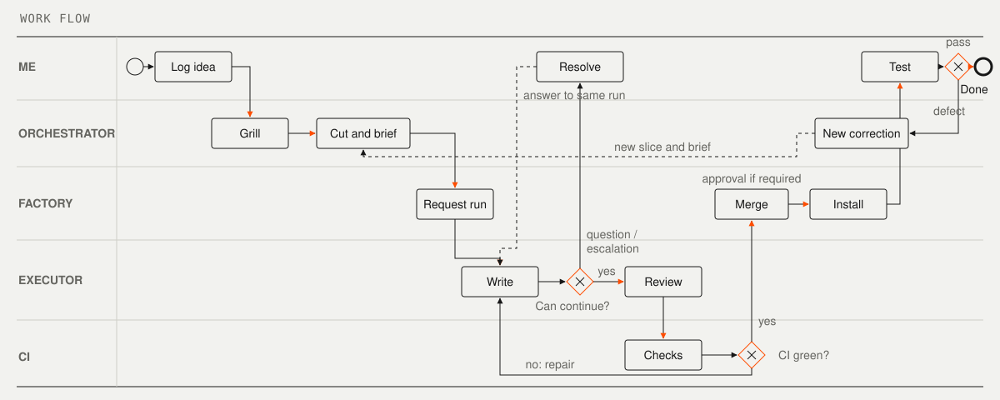
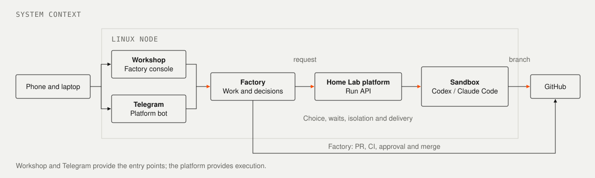

# Factory

My system for turning agreed software work into tested, reviewed pull requests.

In development. Workshop, intake, chats and the runner run on my Linux node today.
Factory uses Python, React and Postgres. It sends slice work to the Home Lab
platform, then manages PRs, CI, merge approval and installation steps.

## Why it exists

A coding agent can write a change. I still need to decide what to build, give it
clear limits, answer questions, check the result and put it into use. Across
projects, that work becomes a queue of chats, branches and unfinished decisions.

I built Factory to keep that process in one place. Each piece of work has a
contract, a state and a record. I can define work from my phone or laptop and
return when a decision needs me.

## What it does

Workshop is the web console for ideas, feature design, project chats and pending
work. Factory schedules ready slices, sends work to the platform, records results
and brings back questions. It opens PRs, tracks CI and required approval, merges
changes and records installation and handover steps.

Factory also has an eval path. Qualified, accepted slices can become cases with a brief,
base commit, hidden test paths and a reference diff. Named configurations select
executors, reviewers and the whole-slice or tickets path for a case set. Slice
attempts receive a test result, a review and a fixed judge's verdict; judge-only
cases skip the hidden-test check. Hidden tests and the reference diff stay out of
the working executor's context. The judge sees the brief and both diffs with
hidden tests removed. Eval attempts use their own branches and never open PRs.
See [evals](docs/evals.md) for qualification and grading.

## How work is structured

| Unit | Boundary and progress |
| --- | --- |
| **Idea** | Something I log before I place it in a feature. It can be classified, explored, promoted or rejected; a linked feature reaching Done marks it implemented. |
| **Feature** | One functionality, one primary area, one repository. Stages: Shortlist → Grilling → Ready → Next → Building → Acceptance or Testing → Done. It can be parked and returned to its prior stage. Functional features go to Acceptance; the others go to Testing. |
| **Slice** | One branch, one PR and one done-criterion. The main path is planned → ready → issued → in review → accepted. It may also be researching, awaiting handover, escalated or dropped. A slice can hold several runs. |
| **Task / ticket** | A step within a slice on the tickets path, with allowed files and a check. Tickets run in order on the slice's branch. |
| **Run** | One execution assigned to one executor, with its request, status and result record. Cutting, ticket work, review and retries can each require runs. |

I choose what enters the queue. The orchestrator records the agreed design and
writes the slice briefs before marking the feature Ready. I, or the chat, can
move it to Next. Factory moves queued features to Building when capacity permits.
When all linked slices are accepted or dropped, it moves the feature to
Acceptance or Testing. A recorded review pass is required before Done.

A brief is a self-contained contract: the goal, fixed decisions, allowed changes,
limits, checks and handover. A slice needs a brief before Ready. The planner
reviews the final handover before acceptance. The slice state `in review` is
this handover stage; the separate PR review run happens before merge.

## How work moves

<picture>
  <source media="(prefers-color-scheme: dark)" srcset="docs/diagrams/work-flow-dark.svg">
  
</picture>

1. **Define.** I log an idea from my phone through Telegram or in Workshop. The
   orchestrator is the chat that plans the work with me. It grills the design one
   question at a time, records the decisions, then cuts the feature into slices
   and writes their briefs.
2. **Run.** Factory submits a ready, due, unpaused slice after its dependencies
   are met. The Home Lab platform runs the executor in an isolated sandbox on the
   node. The slice can run as a whole, or as a cut followed by ordered tickets.
   The platform delivers the resulting branch; Factory opens the PR.
3. **Review and merge.** A separate read-only review run checks the change beside
   CI. Factory records its findings and waits for completion or the review
   deadline. The review verdict is advisory. CI must be green on the current PR
   head, and any required approval must be present before Factory merges.
4. **Install and accept.** Factory coordinates installation through the platform
   deployer for configured repositories, or raises the declared node step. The
   planner checks the handover. Once the feature reaches Acceptance or Testing,
   the chat prepares the checks for me. My feedback can close it as Done or send
   it back to Building with a new correction slice. A merged branch is never
   edited to repair a defect.

A question or escalation holds the slice that raised it; other eligible work can
continue. The orchestrator answers from the agreed contract or asks me for a
decision. Answers and merge notices return to the existing run. Pausing a slice
keeps polling and saves results for resume. Dropping it cancels its open runs.

The decision policy separates four kinds of change:

1. **Automatic:** proceed within the agreed brief and normal checks.
2. **Automatic with stronger checks:** migrations, dependencies and the run path.
3. **Proceed and notify:** continue within scope and bring the decision back.
4. **I decide:** guard files, secret values, deleting irreplaceable data, money
   limits, new public endpoints and making a repository public.

Automatic **path classification** applies classes **1, 2 and 4**, using the
repository's [.github/change-classes](.github/change-classes) from the pinned
base. The highest matching class wins. Class 4 guard paths require my approval.
Class 3 is a decision rule, not a path class accepted by the classifier. The
broader decision policy also applies to decisions that a file path cannot detect.

## How it is built

<picture>
  <source media="(prefers-color-scheme: dark)" srcset="docs/diagrams/system-dark.svg">
  
</picture>

Factory runs as contained services: `ui` serves Workshop, `intake` accepts inbox
arrivals, `sessions` runs chats, and `runner` schedules slices and handles their
results. Python implements the scheduler, runner and service APIs. Workshop uses
React. Postgres stores work state, chats and notices. The version 1 slice document
contract is validated on writes; a private ledger saves run requests before
external effects so a restart can recover them.

[Home Lab](https://github.com/TelesforoAleix/homelab-v2) is the platform beneath
Factory. Its run API owns executor choice, usage waits, concurrency, repository
isolation and branch delivery. Codex and Claude Code execute the work; their
selection is a platform setting. Factory owns the work contracts, PRs, CI, merge
approval, attention and node steps. Chats have a separate execution path. The
platform scans outgoing public commits; Factory checks public PR metadata for
private content before writing it.

## What I designed and decided

I designed the work model and its boundaries: an idea is not a commitment, a
feature needs an agreed design, and each slice has a bounded contract. I kept
questions attached to the slice so a missing answer does not freeze the queue.

I separated orchestration from execution. Factory asks for work by role and
level; the platform chooses and runs the executor. That keeps sandbox rules and
usage waits in one place. I also separated model review from the merge gate:
review findings are evidence, while CI and explicit approval control the merge.

I kept merged results as records and made defects new correction slices. I built
the eval path to compare execution choices against accepted work, with hidden
checks and a fixed judge rather than the executor's own account of success.

## For agents and operators

Use Python 3.13 and uv. Install the locked environment and inspect the CLI:

```sh
uv sync --locked
uv run cplane --help
uv run pytest
```

Stateful commands need a configured Postgres database and libpq. The full test
suite uses synthetic fixtures, temporary git repositories and a disposable
Postgres 17 database; CI provides that database for the required `test` check.
See [operations](docs/operations.md#storage) for test configuration. The platform
delivers executor commits and Factory opens the PR. Work merges through green CI
and required approval.

Read [AGENTS.md](AGENTS.md) before making changes. Planners use the validated
commands with `--actor`; they never edit state JSON by hand or start an executor.
Use `pending`, `show`, `add`, `edit`, `state` and `attention` to inspect and prepare
work. Use `run` for a runner pass in a configured service environment.

- [Command reference](docs/commands.md): planner and operator commands.
- [Runner protocol](docs/runner.md): requests, reviews, messages and recovery.
- [Operations](docs/operations.md): moved storage, runner and Mac tool reference.
- [Node deployment](docs/node.md): services, installs and backups.
- [Inbox and ideas](docs/inbox.md), [project pages](docs/project-pages.md) and
  [evals](docs/evals.md): their contracts and operating details.

The core lives in [cplane/](cplane/). [factory_ui/](factory_ui/) serves the API and
[ui/](ui/) contains the web client. [skills/](skills/) holds the chat, brief,
review and judge instructions; [schema/](schema/) defines document contracts.
[tests/](tests/) holds synthetic tests. [compose.yaml](compose.yaml) defines the
services. Keep private state, run records and outbox data outside this repository.
